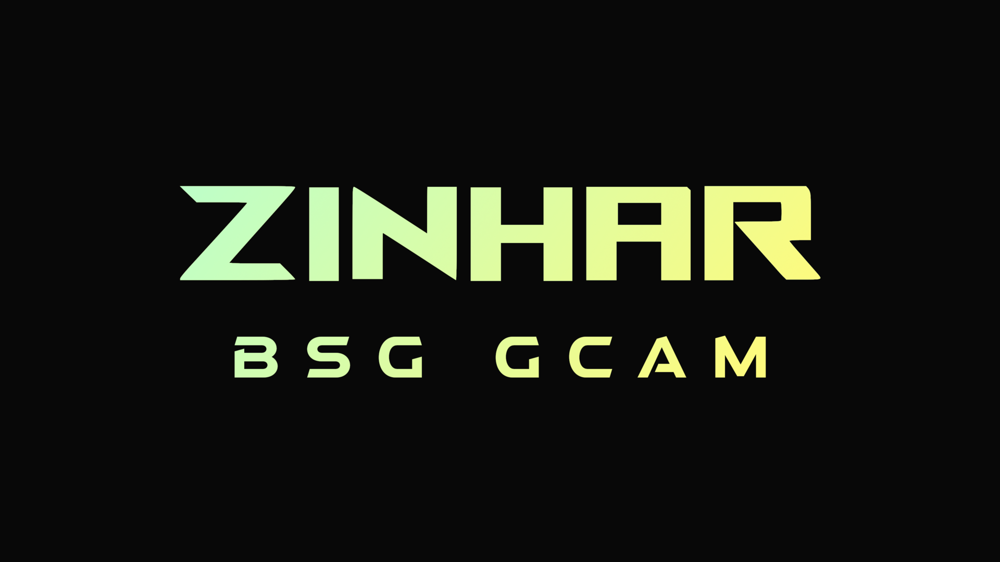
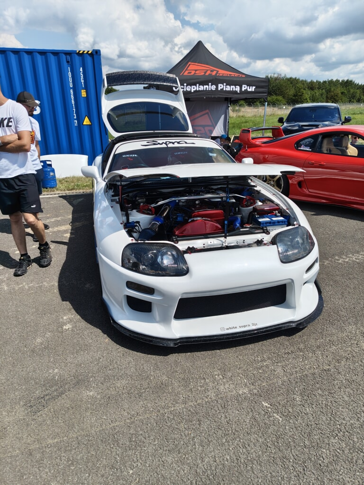
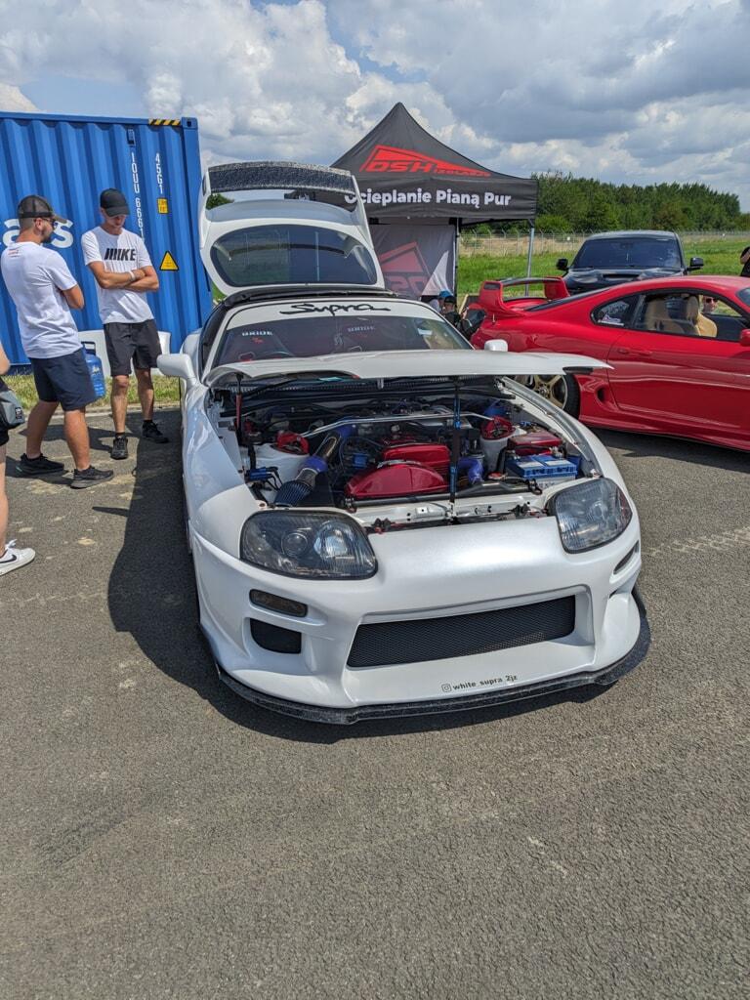
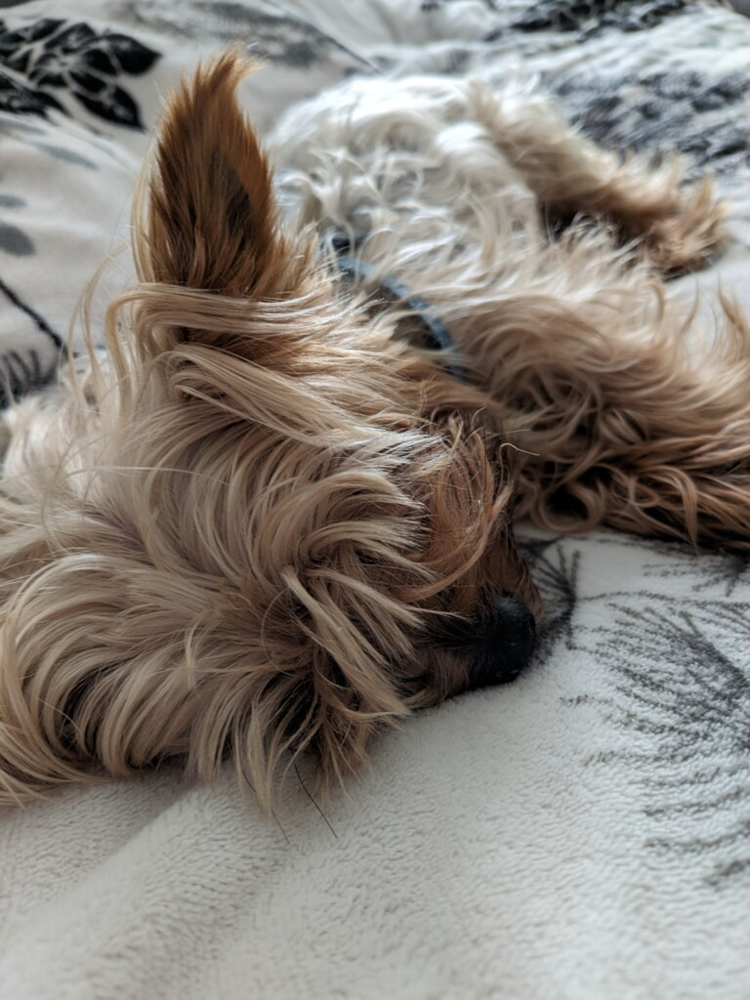
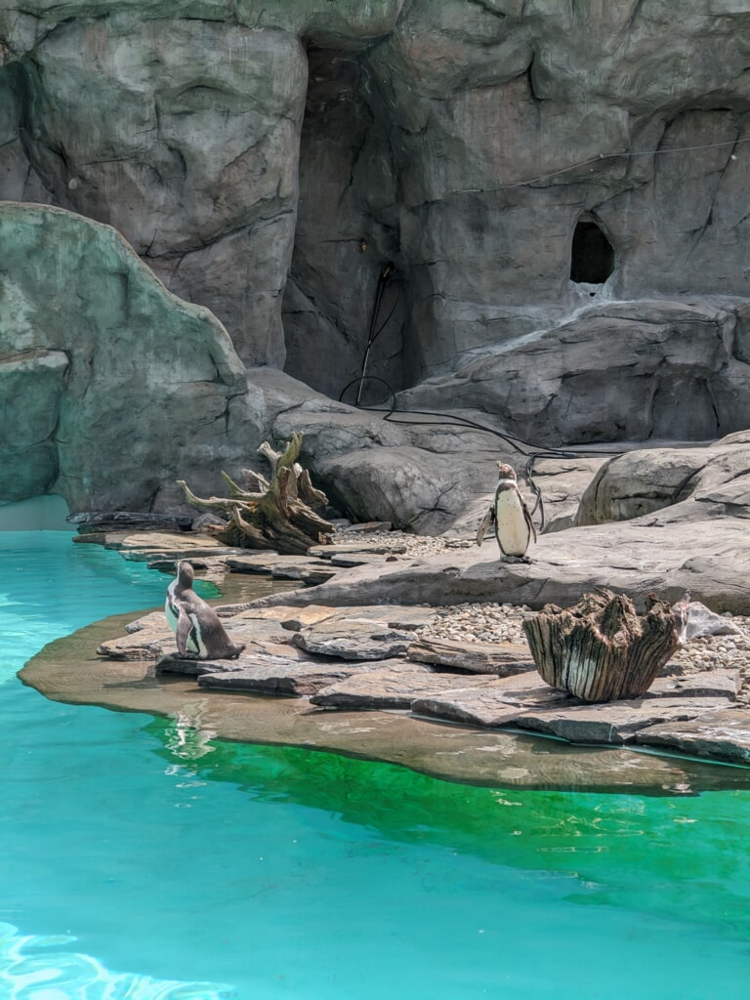
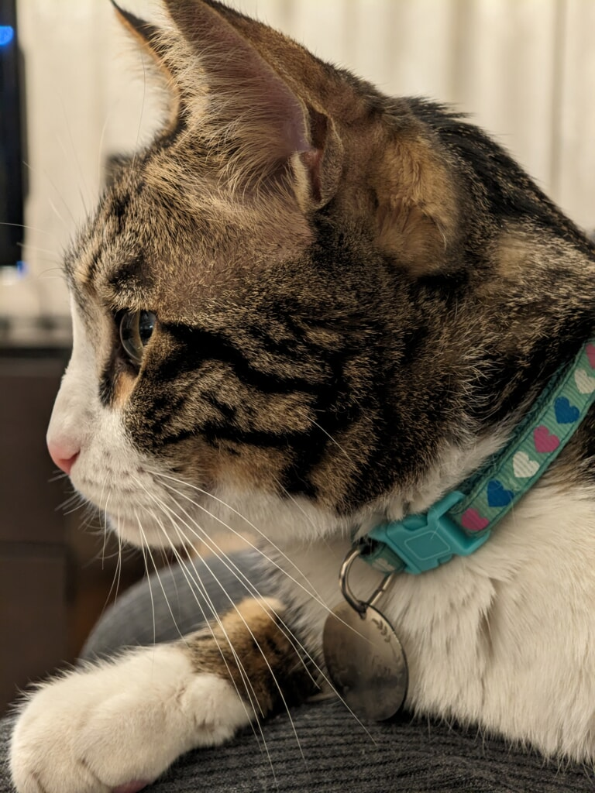
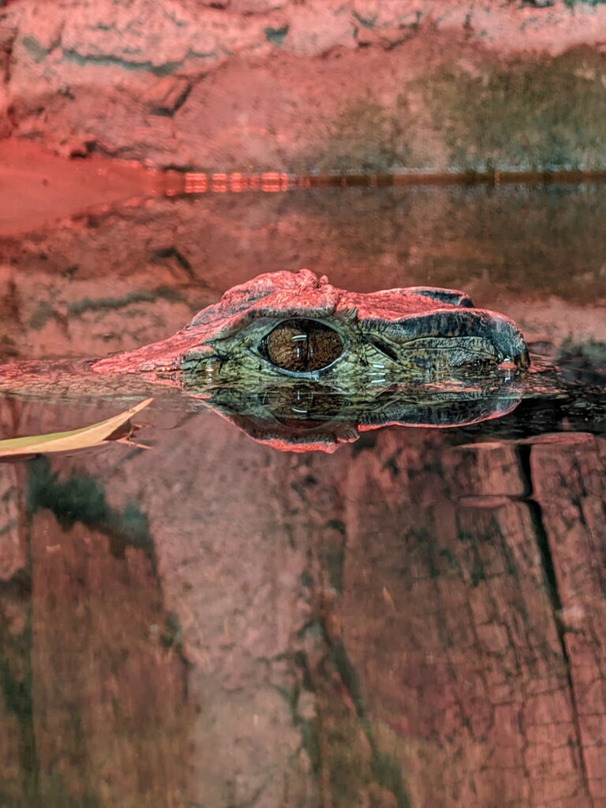
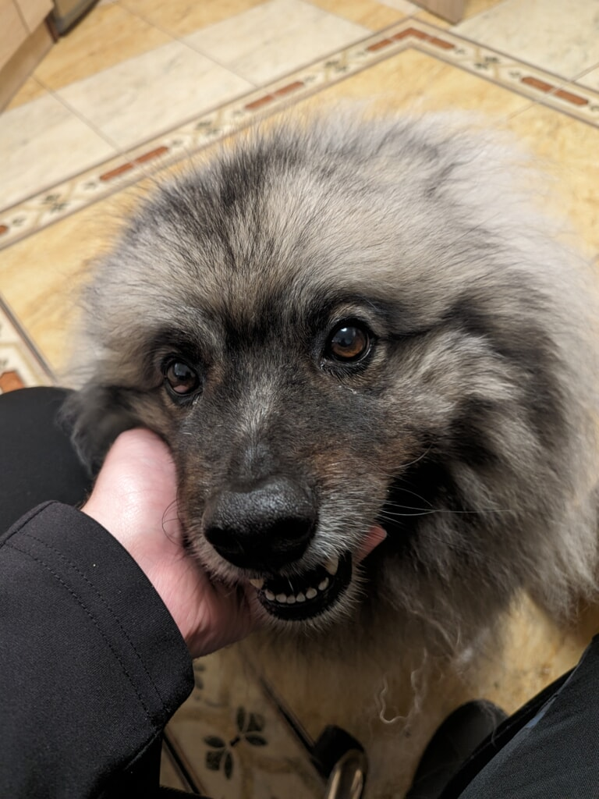

# ZINHAR BSG for Nothing Phone (3a) Pro

<a href="media/ZINHAR-BSG-GCAM.png"></a>

[](https://github.com/FaridZelli/GCam-Asteroids/releases/latest)

## Release info
```
GCam port: BSG 9.4 V38
Style: Detailed / Natural Tones
Configured modules: Main, Telephoto, Ultrawide, Selfie
```
## Features
```
Noise models included for all cameras  
HDR+ Enhanced fine tuning
Advanced module configuration
No face smoothing or contrast adjustment
12 Mbps 4K HEVC OIS video recording  
Up to 6X smaller video files compared to the stock camera  
Fine haptics in the camera app  
```

## Installation

**Prerequisites:**  

- **BSG 9.4 V38** from [Celso Azevedo's website](https://www.celsoazevedo.com/files/android/google-camera/dev-bsg/f/dl382/)
- [ZINHAR XML for Nothing Phone (3a) Pro](https://github.com/FaridZelli/GCam-Asteroids/releases/latest)

**Steps:**  

1. Install BSG 9.4 V38 and open the app.
2. Head over to:

   `More settings > Configs > Load`

   Select the XML file you previously downloaded.
3. Close and re-open GCam, you're done!

## Changelog

- 2025-25: First public release
- 2025-30: White balance adjustments
- 2025-35: Exposure adjustments
- 2025-40: Changed number of HDR frames back to default
- 2025-45: Selfie overhaul
- 2026-01: Selfie and ultrawide improvements
- 2026-05: Dynamic range improvements
- 2026-10: Tone improvements
- 2026-15: Dynamic range improvements
- 2026-40: Updated to BSG 9.4

## Comparison

<table>
  <tr>
    <td align="center" width="360">
      <a href="media/samples/IMG_20260808_130011773.jpg"></a><br>
    </td>
    <td width="50%">
      <p align="center"><strong>Nothing OS 4.1<br>Stock Camera</strong></p>
      <ul>
        <li>Clarity Filter</li>
        <li>Inaccurate Colours</li>
        <li>Steep Tone Curve</li>
      </ul>
    </td>
  </tr>
  <tr>
    <td align="center" width="360">
      <a href="media/samples/PXL_20260808_130006264.jpg"></a><br>
    </td>
    <td width="50%">
      <p align="center"><strong>ZINHAR BSG 9.3 2026-15<br>GCam XML</strong></p>
      <ul>
        <li>No Clarity Filter</li>
        <li>Lifelike Colours</li>
        <li>Balanced Tone Curve</li>
      </ul>
    </td>
  </tr>
</table>

## More samples

<table>
  <tr>
    <td width="20%"><a href="media/samples/PXL_20260105_131551435.jpg"></a></td>
    <td width="20%"><a href="media/samples/PXL_20260505_115145757.jpg"></a></td>
    <td width="20%"><a href="media/samples/PXL_20260104_210229501.jpg"></a></td>
    <td width="20%"><a href="media/samples/PXL_20260505_142725237.jpg"></a></td>
    <td width="20%"><a href="media/samples/PXL_20260614_213839702.jpg"></a></td>
  </tr>
</table>

## Notes

BSG's Official Telegram Channel: [BSG MGC Public Release Channel](https://t.me/Channel_MGC_BSG)  

For XML Creators: [Noise Models](https://raw.githubusercontent.com/FaridZelli/GCam-Asteroids/refs/heads/main/src/NothingPhone3aPro_Noise_Models_Farid_Zelli.zip)  
(These are already included with the XML)

Photography credits: [mysteriouscat](https://github.com/icon225) and [ZINHAR](https://github.com/FaridZelli)
